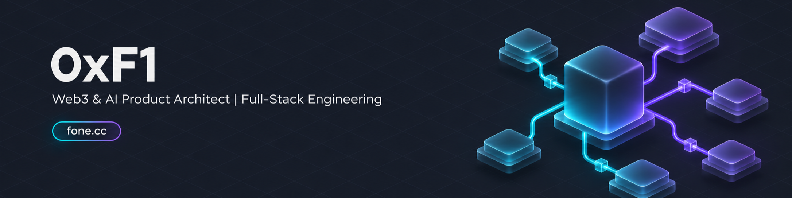

  
  
  
  
  
  
  
  
  
  

## Hi, I'm 0xF1

I'm a full-stack developer. I develop my own Web3 and AI products, writing the smart contracts and backend services as well as the interfaces people use. My stack includes Solidity, Java, TypeScript and React/Next.js.

  
  
  
  

## Products I developed

| Product | What it does |
| --- | --- |
| 💳 **StableIn Payments** | Connects stablecoin checkout to merchant orders and digital delivery. The example store handles notification retries without issuing a second download entitlement for the same order. |
| 🛡️ **Agent Wallet Guard** | Lets an owner manage and revoke an agent's payment permissions. Contract checks reject operations under a revoked session, including an operation signed before revocation. |
| 🏛️ **Aurum RWA** | Supports token issuance and investor workflows. After shared setup, its factory deploys and configures an offering in one transaction and clears its temporary permissions. |
| 🎵 **Fone MusicFlow** | Handles music usage licenses and contributor payouts. Recovery reconciles a restored database with payments already made onchain. |
| ⚡ **ChainPunch** | Runs check-in challenges with onchain rewards. Batch allocation and individual withdrawals keep a blocked recipient from holding up other members' payouts. |
| 🔐 **Fone ProofDesk** | Delivers encrypted advisory reports. Buyers can reopen a report in another browser using the matching reading-key backup and password. |
| 🎫 **NOVA Membership** | Manages membership passes and rewards. Operators can simulate rule drafts, submit them to a separate reviewer account and retain previous versions after publishing changes. |

These workflows are implemented, and I can walk through them in local demos with test assets. MusicFlow uses fixed sample audio in its demo. Agent Wallet Guard uses a Node agent under an existing policy; revoking permission leaves completed payments unchanged. Deployment to a customer's environment needs its own configuration and validation.

For a product demo, purchase enquiry or custom integration, tell me what you need on [LinkedIn](https://www.linkedin.com/in/fonecc/) or [Telegram](https://t.me/fonecc). A short text description is enough to start.

I share product walkthroughs and engineering notes on [X](https://x.com/0xFone). My other repositories include learning exercises and forks. Upstream components and my own changes are identified in the relevant project documentation.

<b>🇨🇳 中文介绍 (Chinese Overview) - 点击展开</b>
 

我是0xF1，做全栈开发。这七款AI与Web3产品都由我开发，可以对外展示和销售。

StableIn已经把稳定币付款接到商户订单和数字交付。Agent Wallet Guard可以管理Agent的付款权限，链上撤权后会拒绝使用旧会话提交的操作。NOVA的成员端与运营后台也已接通，奖励规则经过试算和复核后发布，旧版本保留供查看。

我还开发了RWA发行产品、音乐许可分账系统、链上打卡产品，以及支持加密交付和阅读恢复的付费咨询产品。可以先看现有功能，再讨论购买、集成或定制的范围。演示使用本地环境和测试资产，接入你的实际业务时会另行确认部署配置与验收要求。

